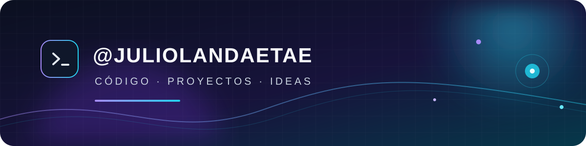

  
   
  
<strong>Proyectos, ideas y cosas hechas con código.</strong>

  
  
  
  

## Sobre este perfil

Un espacio para proyectos de escritorio, web y herramientas prácticas.

### Proyecto público

- [Calculadora en Python](https://github.com/juliolandaetae-ops/calculadorapy)

## Actividad

La serpiente recorre la cuadrícula y va “comiendo” las contribuciones. La animación se actualiza con GitHub Actions.

<picture>
  <source media="(prefers-color-scheme: dark)" srcset="https://raw.githubusercontent.com/juliolandaetae-ops/juliolandaetae-ops/output/github-snake-dark.svg" />
  <source media="(prefers-color-scheme: light)" srcset="https://raw.githubusercontent.com/juliolandaetae-ops/juliolandaetae-ops/output/github-snake.svg" />
  
</picture>

Hecho con GitHub Actions · Tema adaptable claro/oscuro

